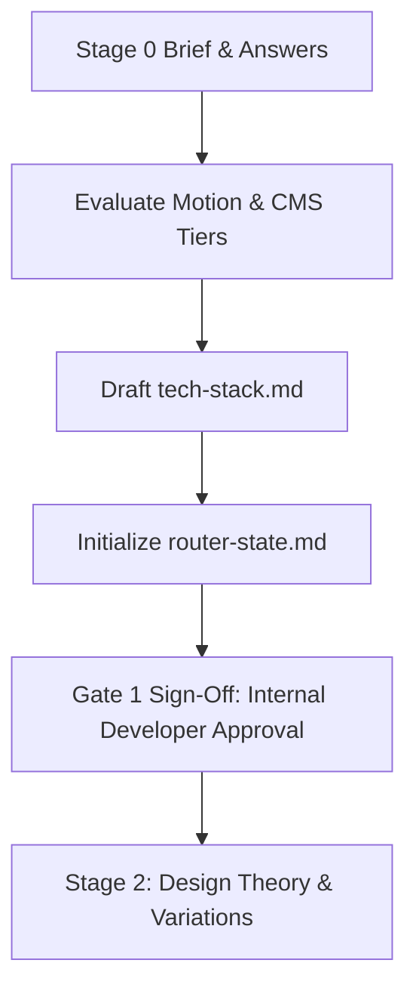

# Stage 1: Tech Stack Specification Runbook

## Overview & Role in Pipeline

Stage 1 locks the technical stack, architectural parameters, component libraries, motion tier, and developer conventions before writing any visual designs or layout code. It establishes a firm contract for Next.js App Router development to ensure consistency, high performance, and zero dependency drift across the team.

---

## Technical Stack Architecture

All NWW client websites strictly follow this standard modern stack:

| Component | Standard Selection | Rule / Constraint |
|---|---|---|
| **Framework** | Next.js App Router (React 19) | Server Components by default; `'use client'` only for interactive islands |
| **Language** | Modern JavaScript (`.js`, `.jsx`) | Strict ES modules, standard syntax, zero compile bloat |
| **Styling** | Tailwind CSS v3 | Configured with design tokens (`globals.css` + CSS variables) |
| **Package Manager** | `pnpm` (strictly enforced) | Zero `npm` or `yarn` lockfiles permitted |
| **Icons** | Lucide React | Feathered, modern SVG icons with tree-shaking |
| **Motion** | GSAP 3 + `@gsap/react` | Configured according to confirmed motion tier (or omitted if `disabled`) |
| **Images & Media** | Sharp + `ResponsiveImage` | Local optimized WebP/AVIF output; zero CLS (`` / `<picture>` with srcset) |
| **Data Layer** | Markdown or NWW CMS Client | Direct Server Component data fetching with on-demand ISR revalidation |

---

## Motion Tier Configuration Rules

Check GSAP Animation Tier in `client-context/answers/batch-02-branding-motion/answers.md`:

1. **Tier: `disabled`**:
   - Do **NOT** install `gsap` or `@gsap/react` in `site/package.json`.
   - Do **NOT** load GSAP agent skills.
   - Use only pure CSS/Tailwind transitions for focus, active, and hover states.
2. **Tier: `low`**:
   - Basic hover transitions, micro-scale transforms, and subtle fade-ins (15–20px translateY).
3. **Tier: `medium` (Default)**:
   - Coordinated section entrance triggers, `ScrollTrigger.batch()`, sticky navbar backdrop blur, and number counters.
4. **Tier: `high`**:
   - Pinned horizontal scroll tracks, scrubbed timelines, SplitText masked reveals, magnetic buttons, and Lenis smooth scroll ticker sync.
5. **Tier: `max`**:
   - Multi-stage 3D perspective card stacking (`rotationX`, `scale`), 60fps 3D card tilt via `quickTo`, and velocity-aware inertia skewing (`self.getVelocity()`).
6. **Tier: `ultra`**:
   - Experiential Three.js/WebGL canvas orchestration driven by master ScrollTrigger scrub, custom GLSL shaders, and 120fps GPU target.

For complete implementation guides and code examples, consult [gsap-animation-tiers.md](../gate-6-scaffolding/gsap-animation-tiers.md).

---

## Deliverables Checklist for Gate 1

Before requesting Gate 1 sign-off:
- [ ] `project-docs/client-review/gate-1-tech-stack/tech-stack.md`: Documented stack specification covering frameworks, package manager, styling, and motion tier.
- [ ] `project-docs/router-state.md`: Initialized live router state with `current_stage: 1` and `gate_1: pending`.

---

## Gate 1 Approval Protocol

1. Present `tech-stack.md` to the internal lead developer or stakeholder.
2. Confirm framework versions, deployment target (Vercel), and motion tier.
3. Halt execution until explicit approval is granted.
4. Update `project-docs/router-state.md` upon approval.

---

## References

- [GSAP Animation Tiers](../gate-6-scaffolding/gsap-animation-tiers.md) — 6-tier motion architecture and code recipes.
- [Code Conventions & Agent Rules](../gate-6-scaffolding/code-conventions.md) — App Router coding rules, line limits, and scoped AGENTS.md.
- [Pipeline Stages & State Machine](../gate-0-intake/pipeline-stages.md) — Master pipeline and state machine specification.
