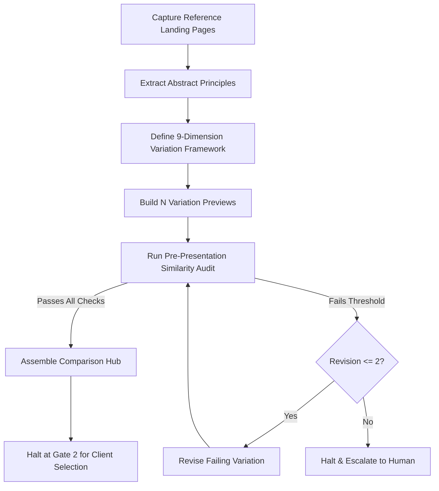

# Gate 2 Design Variations & Similarity Audit Specification

This specification governs the generation, auditing, and presentation of landing page design variations for Stage 2 (Design Theory) and Gate 2 sign-off. It guarantees that client deliverables never clone, mimic, or reproduce a reference website by enforcing a principles-first methodology, quantitative distance boundaries, and pre-presentation similarity verification.

The deliverable outputs are saved to `project-docs/client-review/gate-2-design-theory/`.

---

## 1. Gate 2 Execution Sequence

The Gate 2 workflow proceeds in seven sequential, non-negotiable steps:

1. **Capture References (Analysis Inputs Only):** Execute reference capture (`node skills/create-nww-website/scripts/reference-capture/index.js`) for landing pages specified in `client-context/answers/batch-02-branding-motion/answers.md`.
2. **Extract Abstract Principles:** Synthesize reference observations into abstract design principles in `project-docs/client-review/gate-2-design-theory/design-theory.md` (e.g., "Asymmetric 12-column grid with generous whitespace and high-contrast typography").
3. **Define the Variation Framework:** Formulate an architectural matrix for $N$ variations (default: 3) defining specific choices across the 9 varying dimensions while keeping content and technical constraints constant.
4. **Build $N$ Variation Previews:** Construct $N$ complete, self-contained landing page previews in `project-docs/client-review/gate-2-design-theory/<variation-slug>/index.html` using **HTML + Tailwind CSS + jQuery** (to save future tokens) and the client's authentic copy.
5. **Run Similarity Audit:** Execute the pre-presentation similarity audit, validating text, code, asset, and structural distance against all references and between variations. Compile the internal report to `_checks/similarity-audit.md`.
6. **Assemble Client Comparison Hub & Deploy Publicly:** Compile the plain-language comparison hub at `project-docs/client-review/gate-2-design-theory/index.html` (without prompt copy boxes). Deploy live to GitHub Pages so the client receives a public HTTPS link (never forward localhost).
7. **Halt for Client Decision:** Update `project-docs/router-state.md` to `Gate 2: Awaiting Client Decision Among Variations`. **The agent never approves Gate 2, never selects a variation, and never initiates Stage 3.**



---

## 2. Principles, Not Pixels (Anti-Copy Abstraction Barrier)

Captured reference artifacts (`<slug>/index.html`, `<slug>/content.md`, `<slug>/screenshot.png`, `<slug>/capture.json`) are **strictly analysis inputs**. They serve exclusively to extract high-level design principles, spatial rhythm, and aesthetic tendencies.

### Zero-Tolerance Anti-Copy Prohibitions
When building variations or downstream pages:
- **Zero Copied Text:** No text, slogans, headlines, paragraphs, or microcopy from reference sites may be transferred into client files.
- **Zero Copied Markup & Class Names:** No DOM hierarchies, component markup, CSS class names (e.g., framework selectors, BEM blocks), or element IDs from reference HTML may be reused.
- **Zero Copied Styles:** No CSS rules, inline `style="..."` snippets, keyframes, or CSS variables may be copied from reference stylesheets.
- **Zero Copied Assets:** No images, illustrations, SVGs, logos, icons, font files, or downloadable documents from reference sites may be included or rehosted.
- **Zero Hotlinks:** No external links to reference domains, reference CDNs, or third-party asset hosts may exist in client code.

All markup must be written from scratch using semantic HTML5 and project-defined utility tokens (Tailwind CSS or standard semantic CSS).

---

## 3. The Variation Framework

The variation framework defines what changes between variations and what remains anchored.

### The 9 Varying Dimensions
Each variation must intentionally establish distinct choices across these 9 dimensions:

| # | Dimension | Description | Example Variations |
|---|---|---|---|
| **1** | **Layout & Grid** | Primary spatial system and structural grid. | Asymmetric 12-column offset vs Centered 3-column modular vs Single-column editorial. |
| **2** | **Section Order & Composition** | Sequence of arguments from hero to footer. | Hero -> Social Proof -> Features -> FAQ vs Hero -> Problem Statement -> Interactive Showcase -> CTA. |
| **3** | **Type Pairing & Hierarchy** | Typography pairing, scale contrast, and display treatment. | Geometric Sans + Serif Display vs Neo-Grotesque Display + Neutral Body vs Monospace Accent + Humanist Sans. |
| **4** | **Palette & Contrast Approach** | Color mood, tonal dominance, and contrast intensity. | Deep Obsidian & Laser Accent vs Grounded Slate & Warm Amber vs Warm Editorial Canvas & Deep Charcoal. |
| **5** | **Shape & Component Language** | Geometry of cards, buttons, borders, and surfaces. | Sharp 0px corners with hairline borders vs Soft 16px radii with layered shadows vs Pill tags with ghost borders. |
| **6** | **Motion Character** | Animation personality and interaction pacing. | Snappy, crisp directional shifts vs Weighted, cinematic eases vs Static by design with subtle hover micro-interactions. |
| **7** | **Imagery Treatment** | Visual asset styling, framing, and graphical accents. | Duotone tinted hero photography vs Framed browser window captures vs Minimalist icon-and-metric data callouts. |
| **8** | **Density & Spacing** | Vertical rhythm, padding scale, and information density. | Generous editorial whitespace (120px+ section pads) vs Compact, structured dashboard density (48px pads). |
| **9** | **Navigation Pattern** | Header layout and primary menu interaction. | Floating pill header with blur vs Full-width split header with utility bar vs Minimal right-aligned drawer. |

### The Constants (Non-Negotiable Anchors)
Across all variations, these constants must remain identical:
- **Client Verbatim Content:** The client's authentic copy, business value proposition, real service offerings, and brand tone.
- **Accessibility Standards:** WCAG AA compliance (text contrast >= 4.5:1, headline contrast >= 3:1, minimum 44x44px touch targets).
- **Technical & Stack Constraints:** Vanilla JavaScript / Next.js App Router rules, responsive viewports (320px to 1440px), clean line limits.
- **Approved Principles:** Any brand requirements or design patterns explicitly marked "keep" in `design-theory.md`.

### Variation Count & Personality
- **Default Count:** Exactly **3** variations (unless the client questionnaire explicitly requests 2 or 4).
- **Naming & Personality:** Each variation must be assigned a memorable descriptive title and a one-line plain-language personality summary explaining its emotional tone and structural premise to the client:
  - *Example 1:* **Variation 1: The Modernist Architect** — "Grounded asymmetric grid with bold editorial headlines and warm amber conversion cues."
  - *Example 2:* **Variation 2: The Technical Minimalist** — "High-density clean structure emphasizing technical metrics, dark canvas surfaces, and cyan highlights."
  - *Example 3:* **Variation 3: The Editorial Storyteller** — "Warm tactile palette, generous reading margins, serif display typography, and progressive narrative pacing."

---

## 4. Quantitative Distance Rules

To prevent cosmetic-only changes and ensure meaningful structural distance, every set of variations must satisfy four quantitative thresholds:

1. **Reference Dimensional Divergence:** Each variation must differ from its nearest reference site on **at least 4 of the 9 dimensions**.
2. **Inter-Variation Divergence:** No two variations may share more than **3 identical dimension choices** (they must differ on at least 6 dimensions).
3. **Zero Shared Identifiers & Assets:** Exactly **0** shared class names, element IDs, inline style blocks, SVG icons, image files, or font files with any reference site.
4. **Consecutive Text Overlap (N-gram Limit):** Exactly **0 runs of 6 or more consecutive words** shared with any reference text (`content.md` or `page.html`). Standard common legal entity registrations or boilerplate disclaimers are exempt.

---

## 5. Pre-Presentation Similarity Audit

Before any variation preview or comparison hub is presented to the client, the agent must run the pre-presentation similarity audit.

### Audit Execution Protocol
Perform the audit using read-only analysis commands in Node.js or PowerShell:

1. **Text Overlap Audit:**
   - Tokenize reference `content.md` and variation HTML text into lowercased alphanumeric n-grams.
   - Scan for identical 6-word sequences ($N \ge 6$).
   - Compute Jaccard lexical similarity coefficient (must remain $< 0.15$).
2. **Selector & Token Collision Audit:**
   - Extract all CSS class selectors (`class="..."`) and element IDs (`id="..."`) from reference `page.html`.
   - Extract all class selectors and IDs from the variation HTML.
   - Assert set intersection between reference selectors and variation selectors is empty ($= \emptyset$).
3. **Asset & Isolation Audit:**
   - Scan variation HTML/CSS for `src`, `href`, `url()`, and `<link>`.
   - Verify zero URLs contain reference hostnames or unapproved external CDNs.
   - Confirm all assets are self-contained and load offline.
4. **Structural & Dimensional Divergence Audit:**
   - Tabulate the 9 dimensions across all variations and references in a dimensional comparison matrix.
   - Verify each variation differs on $\ge 4$ dimensions from every reference and $\ge 6$ dimensions from sibling variations.
5. **Side-by-Side Visual Review & Resemblance Rating:**
   - Capture full-page screenshots of each variation alongside reference screenshots (`screenshot-full-1440.png`).
   - The agent assigns a subjective Resemblance Rating (1 to 5, where 1 = completely distinct, 5 = near replica) across all 9 dimensions.
   - Any rating of 4 or 5 triggers an automatic revision.

### Report Location & Heuristic Disclaimer
- **File Location:** Save the internal audit report to `project-docs/client-review/gate-2-design-theory/_checks/similarity-audit.md` (and optional structured data in `similarity-audit.json`).
- **Internal Only:** This report is for developer verification and is **not** exposed in the client-facing review portal.
- **Mandatory Disclaimer Header:** Every audit report must open with:
  > **Notice:** Automated similarity audit results provide heuristic technical evidence only and require human visual inspection. This report does not constitute a legal conclusion or copyright determination.

---

## 6. Failure Recovery & Revision Behavior

If any variation fails a distance threshold, selector collision check, or word overlap limit:

1. **Revise the Variation:** The agent must rewrite the offending section, adjust typography pairings, rearrange section composition, or re-theme the palette.
2. **Threshold Integrity (Never Loosen Limits):** The agent is **strictly forbidden** from loosening, lowering, or bypassing any distance threshold to pass a failing check.
3. **Two-Strike Human Escalation:** If a variation fails the similarity audit after **2 revision attempts**, the agent must halt execution, preserve the audit logs in `_checks/`, and notify the human developer with a summary of the failing criteria.
4. **Missing Client Copy:** If client discovery notes lack content for a section, populate it with clearly labeled placeholder text (e.g., `[CLIENT: Value Proposition Headline]`, marked with `data-placeholder="true"`). **Never populate client copy gaps with text from reference websites.**
5. **Reference Capture Failure:** If a reference site is unreachable, blocked, or fails to render, ask the user to provide screenshots manually. **Never invent, fabricate, or hallucinate reference content or mockups.**

---

## 7. Client-Facing Deliverable Standards

The comparison hub and variation previews are client deliverables and must adhere to professional communication standards:

- **Technology Stack (HTML + Tailwind CSS + jQuery):** Every landing page variation (`<variation-slug>/index.html`) MUST be built using **semantic HTML + Tailwind CSS + jQuery**. This saves future tokens, eliminates heavy JavaScript bundle overhead, and keeps previews lightweight and interactive.
- **Repeating Cards Normal CSS Rule (Token Optimization):** When building landing page variations in HTML + Tailwind CSS + jQuery, whenever components repeat (e.g. 3–6 feature cards, service tiles, metric boxes, pricing tiers, testimonial cards), **use normal CSS** instead of repeating long strings of inline Tailwind utility classes on every individual card element.
  - Define card rules in a scoped `<style>` block in the HTML `<head>`:
    ```html
    <style>
      .feature-card {
        background: #0f172a;
        border: 1px solid rgba(255, 255, 255, 0.1);
        border-radius: 1rem;
        padding: 1.75rem;
        transition: transform 0.25s ease, border-color 0.25s ease, box-shadow 0.25s ease;
      }
      .feature-card:hover {
        transform: translateY(-4px);
        border-color: #00E5FF;
        box-shadow: 0 12px 30px -10px rgba(0, 229, 255, 0.15);
      }
    </style>
    ```
  - In the HTML body, simply reference `<div class="feature-card">` for each repeated instance.
  - **Downstream Transition Rule:** When that same structure and styling is ported into the Next.js `site/` codebase during Stage 6 and Stage 7, convert the repeated card styling using Tailwind's **`@apply`** rule in `site/app/globals.css` (e.g. `@layer components { .feature-card { @apply bg-slate-900 border border-white/10 rounded-2xl p-7 transition-all ...; } }`). This keeps React section components thin, clean, and well under the 250-line limit.
- **Mandatory Public Deployment:** Deliverables will be sent directly to the client. We ALWAYS require a live public deployment (such as GitHub Pages via `.github/workflows/deploy-pages.yml`) to forward to the client. **Forwarding localhost deployment links to the client is strictly forbidden.**
- **No Prompt Copying Section:** The comparison hub is sent directly to the client; do NOT include "copy the prompt" or "Copy My Decision" prompt sections or buttons intended for pasting into an AI assistant.
- **Plain-Language Tone:** All descriptions, titles, and explanations must avoid technical web jargon. Use accessible terminology (e.g., "Warm paper-like background" instead of "HSL 38 25% 94% CSS custom property"; "Clean single-column reading layout" instead of "max-w-prose container with 80ch margin auto").
- **Collapsed Developer Details:** Technical specifications (Tailwind tokens, GSAP easing equations, WCAG contrast ratios, responsive breakpoints) must be enclosed inside `<details><summary>Developer Architecture & Tokens</summary>`.
- **Self-Contained & Offline:** Previews must open via standard browser file access (`file://`) or local preview server without broken styles, broken images, or external web font requests.
- **Typography & Font Licensing:** Use local Google Fonts (OFL WOFF2) fetched via the bundled script (`fetch-fonts.mjs`) or default to high-quality system font stacks with a clear, honest note.

---

## 8. Decision Capture & Revision Protocol

Progress remains halted at Gate 2 until the client explicitly selects a variation.

### Client Decision Confirmation
The client reviews the live public deployment and communicates their variation selection and any adjustments directly via email or chat.

### In-Place Revisions Discipline
If the client asks for revisions at Gate 2 (or any gate):
1. **Never Create Extra Markdown Files:** Do NOT generate `theory-revisions.md`, revision logs, or separate markdown documents.
2. **Make Changes In-Place:** Apply modifications directly to the existing deliverable files (`design-theory.md`, `<variation-slug>/index.html`).
3. **Capture Requirements When Desired:** If there is a substantial new client requirement worth preserving as a note, store it in `client-requirements/` (e.g. `client-requirements/gate-2-client-feedback.md`).

### Router State Wording
Update `project-docs/router-state.md`:
- **Current Gate:** `Gate 2`
- **Gate Status:** `Awaiting Client Decision Among Variations (via public review deployment)`

The agent monitors this file and halts until the client's decision is confirmed. Once confirmed, the chosen variation's tokens and layout principles become the binding foundation for Stage 3 (Page List) through Stage 8.
