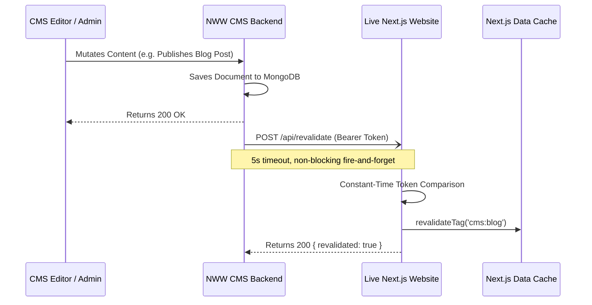

# On-Demand ISR Revalidation & `notifySite` Specification

This document specifies the on-demand Incremental Static Regeneration (ISR) revalidation mechanism between the NWW CMS backend and the Next.js frontend application.

---

## 1. Architectural Overview

When content is modified (created, updated, published, unpublished, or deleted) in the NWW CMS dashboard, the CMS backend fires a non-blocking webhook to the live Next.js website's revalidation handler (`/api/revalidate`). This purges the corresponding cache tag on the Next.js server instantly, rendering fresh content on the next page request without rebuilding or redeploying the site.



---

## 2. Backend Implementation (`notifySite`)

### Step 1: Database Schema Addition (`Website` Model)
Ensure the `Website` schema in `website.model.js` includes the revalidation webhook properties:

```javascript
// website.model.js
const WebsiteSchema = new mongoose.Schema({
  name: { type: String, required: true },
  revalidation_webhook: { 
    type: String, 
    trim: true,
    default: null 
  },
  revalidation_secret: { 
    type: String, 
    trim: true,
    default: null 
  },
  // ... other fields
});
```

### Step 2: Implement the `notifySite` Webhook Dispatcher
Create a dedicated helper `src/helpers/notifySite.js`:

```javascript
// src/helpers/notifySite.js
const WebsiteModel = require('../features/website/website.model');

/**
 * Dispatches an asynchronous on-demand ISR revalidation webhook to the client website.
 * Operates in non-blocking fire-and-forget mode with a 5-second timeout.
 *
 * @param {Object} params
 * @param {string|mongoose.Types.ObjectId} params.websiteId - Target Website ObjectId
 * @param {string} params.resource - Canonical resource name (e.g. 'blog', 'service', 'article', 'product', 'testimonial', 'faq')
 * @param {('create'|'update'|'delete')} [params.operation='update'] - Mutation type
 */
async function notifySite({ websiteId, resource, operation = 'update' }) {
  if (!websiteId || !resource) {
    return;
  }

  try {
    const website = await WebsiteModel.findById(websiteId)
      .select('revalidation_webhook revalidation_secret name')
      .lean();

    if (!website || !website.revalidation_webhook) {
      return; // Webhook not configured for this website
    }

    const payload = JSON.stringify({
      resource: resource.toLowerCase().trim(),
      operation,
      timestamp: Date.now()
    });

    const headers = {
      'Content-Type': 'application/json',
      'User-Agent': 'NWW-CMS-Revalidation-Bot/1.0'
    };

    if (website.revalidation_secret) {
      headers['Authorization'] = `Bearer ${website.revalidation_secret}`;
    }

    // 5-second timeout controller
    const controller = new AbortController();
    const timeoutId = setTimeout(() => controller.abort(), 5000);

    fetch(website.revalidation_webhook, {
      method: 'POST',
      headers,
      body: payload,
      signal: controller.signal
    })
      .then(async (res) => {
        clearTimeout(timeoutId);
        if (!res.ok) {
          const errText = await res.text().catch(() => '');
          console.warn(`[notifySite] Webhook failed (HTTP ${res.status}) for site "${website.name}": ${errText}`);
        } else {
          console.log(`[notifySite] Successfully revalidated "${resource}" on "${website.name}"`);
        }
      })
      .catch((err) => {
        clearTimeout(timeoutId);
        console.warn(`[notifySite] Webhook network error for site "${website.name}": ${err.message}`);
      });
  } catch (err) {
    console.error(`[notifySite Exception]: ${err.message}`);
  }
}

module.exports = { notifySite };
```

### Step 3: Trigger `notifySite` in Module Controllers
Call `notifySite` immediately after successful document creation, update, or deletion across all website-facing modules:

#### Example: `src/features/blog/blog.route.js`
```javascript
const { notifySite } = require('../../helpers/notifySite');

// In Create Route:
router.post('/create-one', async (req, res, next) => {
  try {
    const createdBlog = await BlogService.create(req.body, req.user);
    
    // Trigger on-demand revalidation
    const websiteId = req.user.website || req.body.website;
    notifySite({ websiteId, resource: 'blog', operation: 'create' });

    return ResponseHelper.success(res, createdBlog, 'Created successfully', 201);
  } catch (err) {
    next(err);
  }
});

// In Update Route:
router.put('/update-one/:id', async (req, res, next) => {
  try {
    const updated = await BlogService.update(req.params.id, req.body, req.user);
    
    const websiteId = req.user.website || updated.website;
    notifySite({ websiteId, resource: 'blog', operation: 'update' });

    return ResponseHelper.success(res, updated, 'Updated successfully');
  } catch (err) {
    next(err);
  }
});

// In Delete Route:
router.delete('/delete-one/:id', async (req, res, next) => {
  try {
    const deleted = await BlogService.delete(req.params.id, req.user);
    
    const websiteId = req.user.website || deleted.website;
    notifySite({ websiteId, resource: 'blog', operation: 'delete' });

    return ResponseHelper.success(res, deleted, 'Deleted successfully');
  } catch (err) {
    next(err);
  }
});
```

---

## 3. CMS Dashboard Frontend Configuration

In the CMS dashboard frontend (e.g. `WebsiteForm.jsx` or Website Settings modal), add inputs for `revalidation_webhook` and `revalidation_secret`:

```jsx
// src/pages/website/WebsiteForm.jsx
<div className="grid grid-cols-1 md:grid-cols-2 gap-4 mt-6 p-4 border rounded-lg bg-gray-50">
  <div className="col-span-full">
    <h4 className="text-base font-semibold text-gray-900">Next.js On-Demand Revalidation (ISR)</h4>
    <p className="text-sm text-gray-500">
      Configure your live Next.js website revalidation webhook for instant real-time publishing without rebuilds.
    </p>
  </div>

  <div className="form-group">
    <label className="block text-sm font-medium text-gray-700">Revalidation Webhook URL</label>
    <input
      type="url"
      name="revalidation_webhook"
      placeholder="https://mywebsite.com/api/revalidate"
      value={formData.revalidation_webhook || ''}
      onChange={handleChange}
      className="mt-1 block w-full rounded-md border-gray-300 shadow-sm"
    />
    <span className="text-xs text-gray-400">Endpoint on the Next.js frontend</span>
  </div>

  <div className="form-group">
    <label className="block text-sm font-medium text-gray-700">Revalidation Secret</label>
    <input
      type="password"
      name="revalidation_secret"
      placeholder="Matches REVALIDATE_SECRET in .env.local"
      value={formData.revalidation_secret || ''}
      onChange={handleChange}
      className="mt-1 block w-full rounded-md border-gray-300 shadow-sm"
    />
    <span className="text-xs text-gray-400">Bearer token sent in Authorization header</span>
  </div>
</div>
```

---

## 4. The Next.js Route Handler Implementation

The canonical route handler generated in `site/app/api/revalidate/route.js`:

```javascript
// site/app/api/revalidate/route.js
import crypto from 'node:crypto';
import { revalidateTag } from 'next/cache';
import { NextResponse } from 'next/server';
import { ALLOWED_RESOURCES, tagFor } from '@/lib/cms/revalidation.js';

export async function POST(request) {
  try {
    const authHeader = request.headers.get('authorization') || '';
    const token = authHeader.startsWith('Bearer ') ? authHeader.slice(7) : '';
    const secret = process.env.REVALIDATE_SECRET || '';

    if (!token || !secret) {
      return NextResponse.json({ error: 'Unauthorized' }, { status: 401 });
    }

    // Constant-time token comparison via SHA-256 hash to prevent timing attacks
    const tokenHash = crypto.createHash('sha256').update(token).digest();
    const secretHash = crypto.createHash('sha256').update(secret).digest();

    if (!crypto.timingSafeEqual(tokenHash, secretHash)) {
      return NextResponse.json({ error: 'Unauthorized' }, { status: 401 });
    }

    const body = await request.json().catch(() => ({}));
    const { resource } = body;

    if (!resource || !ALLOWED_RESOURCES.includes(resource)) {
      return NextResponse.json(
        { error: 'Invalid or missing resource', allowed: ALLOWED_RESOURCES },
        { status: 400 }
      );
    }

    const tagToRevalidate = tagFor(resource);
    revalidateTag(tagToRevalidate);

    return NextResponse.json({
      revalidated: true,
      resource,
      tag: tagToRevalidate,
      timestamp: Date.now(),
    });
  } catch (err) {
    return NextResponse.json(
      { error: 'Internal revalidation error', message: err.message },
      { status: 500 }
    );
  }
}
```
