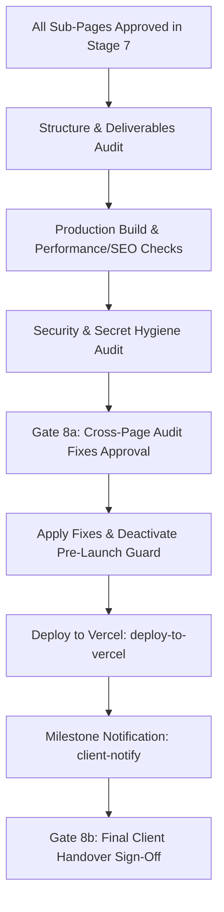

# Stage 8: Final Verification & Handover Runbook

## Overview & Role in Pipeline

Stage 8 is the final stage of the website creation lifecycle. In this stage, the agent performs comprehensive automated compliance audits, verifies the production build, runs SEO and performance checks, conducts security and secret hygiene audits, presents audit findings for Gate 8a approval, deactivates the pre-launch preview guard, deploys the site live to Vercel, dispatches the client completion email, and delivers the handover package for Gate 8b sign-off.



---

## Step 1: Automated Structure & Deliverables Compliance Audit

Run the repository structure auditor utility to verify all deliverables, file naming rules, and strict line count constraints across `site/` and `project-docs/`:

```bash
node skills/create-nww-website/scripts/structure-audit/index.js --strict
```

The script verifies:
1. All routes from `project-docs/client-review/gate-3-page-list/page-list.md` exist and are marked completed (`- [x]`).
2. Thin page server components (`page.js`) do not exceed **80 lines**.
3. Section components do not exceed **250 lines** and have `// section: <id>` and `data-section="<id>"` markers.
4. No unstated markdown files were generated (zero `theory-revisions.md`, `page-design-notes.md`, `migration-inventory.md`).
5. Generates the compliance audit report at `project-docs/client-review/gate-8-final-verification/structure-audit.md`.

---

## Step 2: Production Build & Asset Verification

Execute the production build within `site/` to guarantee zero compilation, route, or hydration errors:

```bash
cd site
pnpm build
pnpm check:all
```

Verify:
- Clean build with zero warnings or hydration errors.
- Image byte budgets: LCP candidate <= 100 KB, other images <= 60 KB, SVG <= 5 KB.
- Local fonts render cleanly without external network calls.

---

## Step 3: Technical SEO & Performance Audit

Test the production build using companion SEO utilities:

```bash
# 1. Sitemap and Robots Parser Check
node skills/create-nww-website/scripts/seo/sitemap-robots-parser.js --url http://localhost:3000

# 2. Performance & Core Web Vitals (CWV) Check
node skills/create-nww-website/scripts/seo/pagespeed-check.js --url http://localhost:3000
```

Verify:
- `robots.txt` syntax is valid and permits search crawlers once launched.
- `sitemap.xml` contains all public static and dynamic CMS routes with valid timestamps.
- Exactly one `<h1>` per page.
- Structured data JSON-LD validates against schema definitions.

---

## Step 4: Security, CMS & Secret Hygiene Audit

Conduct final security checks:
1. **Zero Secret Leaks:** Verify that `CMS_SITE_KEY`, `REVALIDATE_SECRET`, `PIXABAY_API_KEY`, `PEXELS_API_KEY`, and `UNSPLASH_ACCESS_KEY` do not appear anywhere in client bundles, HTML outputs, or public git-tracked files.
2. **CMS Webhook Verification (if `cms: cms`):** Test `POST /api/revalidate` with bearer token to ensure instant tag purging within 5 seconds.
3. **Stock Provenance & Credits:** Verify that `project-docs/stock-provenance.json` is complete, `/credits` page renders, and Unsplash images include proper photographer attribution.

---

## Step 5: Gate 8a Approval (Cross-Page Fixes)

If the audits in Steps 1–4 reveal any issues:
1. Document the proposed fixes in `project-docs/client-review/gate-8-final-verification/structure-audit.md`.
2. Present the audit findings to the user and request approval before applying modifications to approved pages.
3. Halt execution until Gate 8a sign-off is granted.
4. Apply the approved fixes and re-run `pnpm check:all`.

---

## Step 6: Pre-Launch Guard Deactivation

Once audit fixes are approved and verified:
1. Open `site/.env.local` (and production deployment environment).
2. Set:
   ```env
   NEXT_PUBLIC_PREVIEW_GUARD="false"
   ```
3. Verify that the `<PreviewBanner />` disappears and search engine robots directives update to `index, follow`.

---

## Step 7: Live Vercel Deployment & Handover (Gate 8b)

1. **Deploy to Vercel:** Deploy the production Next.js website using the official Vercel deployment agent skill:
   ```bash
   DISABLE_TELEMETRY=1 npx skills add https://github.com/vercel-labs/agent-skills --skill deploy-to-vercel
   ```
2. **Client Milestone Email:** Send the client completion notification containing the live production URL:
   ```bash
   node skills/create-nww-website/scripts/client-notify/index.js
   ```
3. **Deliver Client Handover Package:**
   - Deliver project maintenance notes in `site/AGENTS.md`.
   - Provide NWW CMS admin instructions (if CMS active).
   - Confirm backup of original assets in `assets-source/`.
4. Update `project-docs/router-state.md` to `Gate 8b: Final Project Handover Complete`.

---

## Gate 8 Checklist

Before declaring project completion:
- [ ] Structure and deliverable audit passed (`structure-audit.md` generated).
- [ ] `pnpm build` compiles cleanly with zero errors.
- [ ] Zero API keys or secrets leaked in code or client bundles.
- [ ] Pre-launch guard deactivated (`NEXT_PUBLIC_PREVIEW_GUARD="false"`).
- [ ] Next.js application deployed live to Vercel via `deploy-to-vercel`.
- [ ] Milestone notification email dispatched via `client-notify`.
- [ ] Final handover sign-off confirmed by human approver (Gate 8b).
