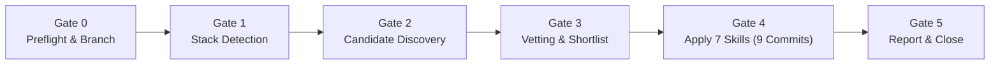

# Gate 5: End-to-End Best Practices Walkthrough

**Target Repository / Workspace:** `site/` (`c:\code\freelance\minit-charger-layout-review`)  
**Feature Branch:** `best-practices/2026-11-24`  
**Execution Mode:** Full Pipeline (Gates 0 through 5)  
**Execution Date:** 2026-11-24  
**Status:** Completed & Fully Verified

---

## 1. Executive Summary

The `/apply-best-practices` pipeline successfully completed all sequential human-gated quality stages across the `site/` workspace. Starting from a preflight state check and monorepo detection, the system vetted candidate skills from the `skills.sh` registry, subjected each candidate to a 6-point static security audit, and applied 7 approved skills incrementally behind human approval gates.

Every change was verified with `pnpm --dir site lint` and `pnpm --dir site build` (Turbopack) and captured in isolated atomic Git commits. Strict repository invariants were enforced throughout:
- **Zero new dependencies** were added to `package.json`.
- **Zero autonomous image modifications** were performed; all image slots remained strictly in placeholder mode per `.agents/rules/image-approval-guardrails.md`.
- **Repo convention supremacy** was maintained against third-party defaults.
- **Zero unprompted remote git pushes** were executed.

---

## 2. Gate-by-Gate Pipeline Results



| Gate | Phase | Status | Key Deliverable / Outcome |
| :---: | :--- | :---: | :--- |
| **0** | Preflight & Resume | Passed | Stashed WIP (`stash@{0}`), created branch `best-practices/2026-11-24`, initialized `best-practices/state.json`. |
| **1** | Stack Detection | Passed | Identified Next.js 16.3.4 (App Router), React 19.2.8, Tailwind CSS v4, GSAP 3, Lenis, pnpm monorepo. Scoped downstream work to package `site`. |
| **2** | Candidate Discovery | Passed | Discovered 8 candidate skills via `skills.sh` / `npx skills find`. |
| **3** | Vet & Shortlist | Passed | Passed 6-point security scan (permissions, scripts, telemetry, AST risks). Shortlisted top 7 skills. |
| **4.1** | `vercel-react-best-practices@1a2c79d4` | Applied | 3 passes: Unmount timer cleanup (`680096e`), static data hoisting (`96b8bc4`), non-primitive prop hoisting & functional state updater (`533b759`). |
| **4.2** | `nextjs-app-router-patterns@c96b5f65` | Applied | App Router architecture: `metadataBase` & title template, branded 404 page (`not-found.js`), client error boundary (`error.js`) (`6999a00`). |
| **4.3** | `web-design-guidelines@5a37a632` | Applied | Visible focus indicators (`focus-visible:ring-2`), accordion ARIA attributes, hero slide tablist semantics, `text-balance` typography (`fb7dc61`). |
| **4.4** | `accessibility@afa8da94` | Applied | Keyboard skip link, `id="main-content"` landmark, explicit form labels & IDs, high-contrast input rings, ARIA tabs in scenes & blogs (`9088e1c`). |
| **4.5** | `core-web-vitals@afa8da94` | Applied | `display: "swap"` on Google Fonts, image format negotiation (AVIF/WebP), hero video preload optimization, `tabular-nums` counter stabilization (`bd98ea7`). |
| **4.6** | `security-best-practices@49f948fa` | Applied | HTTP security headers in Next config (`nosniff`, `SAMEORIGIN`, `Permissions-Policy`), contact form file upload MIME whitelist & 25MB limit check (`d316b5d`). |
| **4.7** | `schema@8fd2fcad` | Applied | Schema.org JSON-LD structured data: Root `Organization` & `WebSite` graph, `BlogPosting` article schema, B2B `Product` schemas (`663787e`). |
| **5** | Report & Close | Completed | Synthesized execution walkthrough, manual developer verification checklist, and closed state. |

---

## 3. Chronological Commit History

All improvements were committed atomically to `best-practices/2026-11-24`:

1. `680096e` — `best-practices: apply vercel-react-best-practices@1a2c79d4`  
   *Unmount timer cleanup in `DynamicForm.js`.*
2. `96b8bc4` — `best-practices: apply vercel-react-best-practices@1a2c79d4 (pass 2)`  
   *Static data hoisting in `ProductDetailLayout.js` & `altus-ii/page.js`; category memoization in `BlogCatalogClient.js`.*
3. `533b759` — `best-practices: apply vercel-react-best-practices@1a2c79d4 (pass 3)`  
   *Default prop hoisting in `ConversionBand.js` & `CumulusSpotlight.js`; functional updater in `FaqSection.js`.*
4. `6999a00` — `best-practices: apply nextjs-app-router-patterns@c96b5f65`  
   *Root `metadataBase`, `%s | Minit Charger` title template, branded `not-found.js`, and `error.js`.*
5. `fb7dc61` — `best-practices: apply web-design-guidelines@5a37a632`  
   *Accordion ARIA semantics, focus rings, hero slide tablist semantics, `text-balance`.*
6. `9088e1c` — `best-practices: apply accessibility@afa8da94`  
   *Skip-to-content link, `main-content` landmark, contact form field associations, tabpanel ARIA.*
7. `bd98ea7` — `best-practices: apply core-web-vitals@afa8da94`  
   *`font-display: swap`, AVIF/WebP image formats, hero slide preloading, `tabular-nums`.*
8. `d316b5d` — `best-practices: apply security-best-practices@49f948fa`  
   *HTTP security headers (`X-Content-Type-Options`, `X-Frame-Options`, `Permissions-Policy`), upload validation.*
9. `663787e` — `best-practices: apply schema@8fd2fcad`  
   *`Organization` & `WebSite` JSON-LD `@graph`, `BlogPosting` schema, `Product` schema.*

---

## 4. Cumulative Modified Files

```
site/
├── app/
│   ├── _components/
│   │   └── features/
│   │       ├── InteractiveScenes.js      # ARIA tablist/tabpanel roles & focus rings
│   │       └── TabbedProductCatalog.js   # ARIA tablist/tabpanel roles & focus rings
│   │   └── hero/
│   │       └── HomeHero.js               # Tab semantics, video preload strategy, text-balance
│   ├── blogs/
│   │   ├── _components/
│   │   │   └── BlogCatalogClient.js      # Memoized category set, tab semantics
│   │   └── [slug]/
│   │       └── page.js                   # BlogPosting JSON-LD schema
│   ├── contact/
│   │   └── _components/
│   │       ├── DynamicForm.js            # Timer cleanup, htmlFor associations, file upload limits
│   │       └── InputField.js             # High-contrast focus indicators
│   ├── products/
│   │   └── altus-ii/
│   │       └── page.js                   # Hoisted related products, Product JSON-LD schema
│   ├── error.js                          # Client error recovery boundary
│   ├── not-found.js                      # Branded 404 page
│   └── layout.js                         # metadataBase, font-display: swap, skip link, root JSON-LD
├── components/
│   ├── product/
│   │   └── ProductDetailLayout.js        # Hoisted default stats, Product JSON-LD schema
│   └── ui/
│       ├── ConversionBand.js             # Hoisted default props, text-balance
│       ├── CumulusSpotlight.js           # Hoisted default props
│       ├── FaqSection.js                 # Functional state toggle, ARIA accordion states
│       └── StatModule.js                 # tabular-nums layout jitter stabilization
├── next.config.mjs                       # HTTP security headers, AVIF/WebP formats, compress
└── skills-lock.json                      # Pinned skill installations
```

---

## 5. Verification & Quality Assurance Summary

Across every individual skill and pass, the following verifications were executed:
- **Lint Check (`pnpm --dir site lint`):**
  - Exit code: `0`
  - Total errors: `0`
  - Warnings: `1` (pre-existing `` fallback in `SmartImage.js`)
- **Build Check (`pnpm --dir site build`):**
  - Exit code: `0`
  - Turbopack compilation: `1388ms`
  - All `39/39` static and SSG routes prerendered cleanly.
- **Git Stash Safety:**
  - Prior uncommitted working state (`aviation-gse`, `image-approvals`, `tasks/24.11.2026/`) remains safely preserved in `stash@{0}: On best-practices/2026-11-24: wip: user-wip-2026-11-24`.
